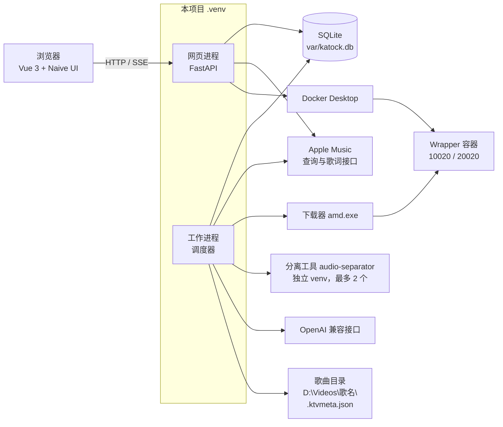
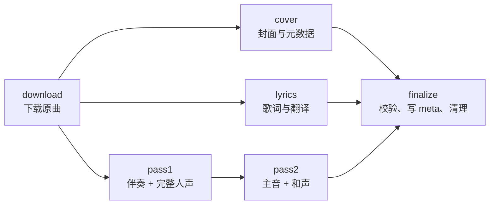
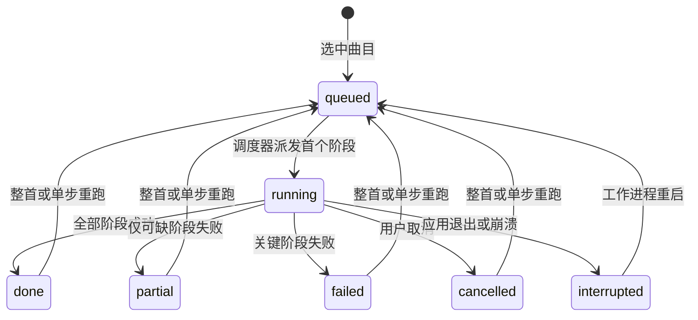

# Cyber_KaTockVocal 架构设计文档

| 项 | 内容 |
|---|---|
| 依据 | [`docs/PRD.md`](./PRD.md) |
| 适用范围 | P0 全部功能 |
| 运行环境 | 本机 Windows 10/11，单用户，仅 `127.0.0.1` 访问 |

本文档描述软件当前确认的结构与待办。需求细节以 PRD 为准，本文只写“怎么实现”。

---

## 1. 一页看懂

软件由**两个常驻进程**组成，共用一个 SQLite 数据库：

- **网页进程**：浏览器界面与 HTTP 接口。负责环境体检、拉起 Docker、Apple 登录与验证码、搜歌、提交任务、展示进度、配置。它也是启动入口，负责拉起并守护工作进程。
- **工作进程**：只负责执行任务队列。按资源配额调度每首歌的各个阶段，调用外部程序完成下载、转码、分离，并把结果写入歌曲目录。

耗时、易崩溃的工作（下载、分离）都在**外部子进程**里完成，崩溃只影响当前阶段，队列可以从断点续跑。



---

## 2. 技术栈

| 层 | 选型 | 说明 |
|---|---|---|
| 后端语言 | Python 3.12 | 项目专属 venv `.venv`，由 uv 创建与锁定，仅本项目使用 |
| Web 框架 | FastAPI + Uvicorn | 仅绑定 `127.0.0.1`，默认端口 `8765`（可配置） |
| 实时推送 | Server-Sent Events | 进度、体检、队列状态单向推送到浏览器 |
| 数据库 | SQLite（标准库 `sqlite3`，WAL 模式） | 版本化 SQL 迁移脚本 |
| 配置 | `var/config.toml` + Pydantic 校验 | 路径、并发、模型名等非敏感项 |
| 敏感信息 | Windows DPAPI（`pywin32`） | 加密后存入 SQLite `secrets` 表 |
| HTTP 客户端 | httpx | Apple 接口、翻译接口 |
| 分离工具 | `audio-separator` CLI（[python-audio-separator](https://github.com/nomadkaraoke/python-audio-separator)） | UVR 模型的专用命令行工具，作为外部工具调用；安装在独立 venv `tools\audio-separator\.venv`，内含 PyTorch cu128 |
| 音频工具 | ffmpeg / ffprobe（`D:\ffmpeg\bin`） | 转码、校验、写元数据 |
| 下载器 | apple-music-downloader，本机编译为 `tools\amd\amd.exe` | 源码位于 `D:\Download\apple-music-downloader-main`，Go 仅用于编译 |
| 解密服务 | Wrapper（Docker 容器） | 唯一运行在 Docker 中的组件 |
| 桌面通知 | `windows-toasts` | 队列结束时由工作进程发出 |
| 前端 | Vite + Vue 3 + TypeScript | `<script setup>` 组合式写法 |
| UI 组件库 | Naive UI | 默认深色主题，统一主题变量，支持切换浅色 |
| 前端状态与路由 | Pinia + Vue Router | |
| 图标 | `@vicons/ionicons5` | |
| 前端包管理 | pnpm（Node 22） | |
| 质量工具 | ruff、mypy、pytest；vue-tsc、ESLint | |

---

## 3. 进程模型

### 3.1 进程职责

| 进程 | 启动方式 | 职责 | 依赖加载 |
|---|---|---|---|
| 网页进程 | `.venv\Scripts\python -m katock` | HTTP/SSE、体检、Docker 与 Wrapper 管理、登录与验证码、搜歌与清单解析、配置、守护工作进程、打开浏览器 | 轻量依赖 |
| 工作进程 | 由网页进程拉起 `python -m katock.worker` | 队列调度、执行阶段、写盘、记录耗时、发送通知 | 轻量依赖 |
| 分离工具进程 | 由工作进程拉起 `tools\audio-separator\.venv\Scripts\audio-separator.exe` | 单次模型推理，输出两个 stem | 工具自带的 PyTorch |

网页进程与工作进程使用项目 `.venv`，只装轻量依赖，启动快、内存小。分离工具与下载器、ffmpeg 同等对待，都是工作进程调用的外部命令行工具。

### 3.2 进程间通信

两个常驻进程只通过 SQLite 交换信息：

| 方向 | 表 | 内容 |
|---|---|---|
| 网页 → 工作 | `commands` | 取消任务、暂停/继续队列、重跑阶段 |
| 工作 → 网页 | `events` | 阶段开始/结束、进度、ETA、错误 |
| 网页 → 工作 | `env_status` | Docker、Wrapper、登录态等体检结果 |
| 双向 | `jobs`、`steps` | 任务与阶段状态 |

网页进程每秒读取一次新事件并通过 SSE 推送，满足“进度更新延迟 ≤ 3 秒”。

### 3.3 生命周期

1. 网页进程启动：执行数据库迁移、加载配置、启动 HTTP 服务、打开浏览器、开始体检（含拉起 Docker）。
2. 网页进程拉起工作进程；工作进程意外退出时 5 秒后自动重启。
3. 工作进程启动：把上次处于“执行中”的阶段置为“已中断”，再把这些任务放回队列，从未完成的阶段续跑。
4. 用户退出应用：网页进程通知工作进程停止；工作进程终止正在运行的子进程，阶段置为“已中断”。Docker Desktop 保持原样运行。

---

## 4. 代码目录

```
Cyber_KaTockVocal/
├── AGENTS.md
├── pyproject.toml / uv.lock          # Python 依赖（单一 venv）
├── docs/
│   ├── PRD.md
│   └── 架构设计文档.md
├── src/katock/
│   ├── __main__.py                   # 启动入口 = 网页进程
│   ├── config.py                     # 配置模型与加载
│   ├── web/                          # 网页进程
│   │   ├── api/                      # 路由：health / auth / search / jobs / settings / events
│   │   ├── services/                 # 体检、环境管理、搜索、工作进程守护
│   │   └── static.py                 # 托管前端构建产物
│   ├── worker/                       # 工作进程
│   │   ├── __main__.py
│   │   ├── scheduler.py              # 资源配额与阶段派发
│   │   ├── pipeline.py               # 阶段依赖图
│   │   └── steps/                    # download / cover / lyrics / pass1 / pass2 / finalize
│   ├── adapters/                     # 外部依赖适配器（见第 5 节）
│   ├── domain/                       # 纯逻辑：状态机、命名、LRC/SRT、语言判定、ETA
│   ├── storage/                      # 数据库、迁移、.ktvmeta.json、安全写盘
│   └── security/                     # DPAPI、日志脱敏
├── frontend/                         # Vite + Vue 3 + Naive UI
├── tests/                            # pytest
├── scripts/                          # setup.ps1、setup-separator.ps1、build-downloader.ps1、dev.ps1
├── tools/                            # 外部工具（仅本机，列入 .gitignore）
│   ├── amd/amd.exe                   # 本机编译的下载器
│   └── audio-separator/.venv/        # 分离工具的独立 venv
└── var/                              # 运行时数据（仅本机，列入 .gitignore）
    ├── katock.db
    ├── config.toml
    ├── models/                       # 分离模型目录（ckpt 硬链接 + yaml）
    ├── work/<jobId>/                 # 工作目录
    └── logs/
```

`domain/` 只包含纯函数与数据结构，可直接单元测试。所有外部程序与网络调用只出现在 `adapters/`。

---

## 5. 外部依赖适配器

每个适配器提供统一的三件事：**体检**（返回可定位的错误信息）、**调用**（以参数列表启动子进程或发 HTTP 请求）、**错误分类**（映射到用户可读的失败原因）。

| 适配器 | 所在进程 | 职责 |
|---|---|---|
| `docker` | 网页 | 检测守护进程；未运行时启动 `Docker Desktop.exe`，每 2 秒轮询，120 秒超时 |
| `wrapper` | 网页 | 检查容器与 10020/20020 端口；`docker compose up -d`；首次登录与验证码 |
| `catalog` | 网页、工作 | Apple 查询：关键词搜索、链接解析、专辑/歌单曲目、封面地址、歌词 |
| `downloader` | 工作 | 调用 `amd.exe --song <链接>` 下载单曲到工作目录 |
| `ffmpeg` | 工作 | ALAC 转 FLAC、写元数据与封面、ffprobe 校验 |
| `separator` | 工作 | 调用 `audio-separator` CLI、解析进度输出、按附录 A 映射产物 |
| `translator` | 工作 | OpenAI 兼容接口逐句翻译、连接测试 |
| `notifier` | 工作 | Windows 桌面通知与提示音 |
| `shell` | 网页 | 打开文件夹、复制路径 |

### 5.1 Docker 与 Wrapper

- Docker Desktop 默认路径：`C:\Users\Administrator\AppData\Local\Programs\DockerDesktop\Docker Desktop.exe`（可配置）。
- Docker 启动期间，环境状态为“正在启动 Docker”，并单独显示已等待时长。这段时间里的下载阶段处于“等待环境”。
- Wrapper 目录：`D:\Download\Wrapper.x86_64.latest`。镜像缺失时执行 `docker compose build`（基础镜像 `debian:13.2`），之后以 `docker compose up -d` 启动。`compose.yaml` 需包含 `privileged: true` 与 10020/20020/30020 端口映射。
- Wrapper 的构建、登录、排障方法以本机 skill `C:\Users\Administrator\.workbuddy\skills\apple-music-downloader` 为参考。
- 首次登录流程：
  1. Apple ID 与密码从 DPAPI 解密后，**仅作为环境变量** `USERNAME`、`PASSWORD` 传给 `docker compose up -d` 子进程。
  2. 轮询 `docker logs --tail`，出现 2FA 提示时，界面弹出验证码输入框。
  3. 用户提交验证码后，网页进程执行 `docker exec <容器> sh -c "echo -n '<验证码>' > /app/rootfs/data/data/com.apple.android.music/files/2fa.txt"`，在容器内部直接写入。
  4. 日志出现 `listening 0.0.0.0:10020` 即登录成功；60 秒内未出现则提示“验证码已过期，重新发起”。
  5. 重新发起时，先清理 `2fa.txt` 与 `mpl_db`，再重启容器。
- 登录成功后，令牌库保存在 `rootfs/data/.../mpl_db/kvs.sqlitedb`；以后启动容器只需 `compose up -d`，日志出现 `listening` 即就绪。

### 5.2 曲目查询与歌词（`catalog`）

- 通过 Apple Music 网页版使用的目录接口查询，返回结构化 JSON：搜索候选、专辑/歌单曲目、`trackId`、时长、年份、封面 URL 模板。
- 开发者令牌自动从 Apple Music 网页获取并缓存；歌词需要用户提供的 `media-user-token`（DPAPI 加密存储）。
- 歌词取 TTML 格式，从中读取语言标签与行级时间轴，再由 `domain/lyrics` 生成 LRC 与 SRT。
- 繁简互通搜索：同一关键词分别以原文、简体、繁体各查询一次，按 `trackId` 去重合并。

### 5.3 下载（`downloader`）

- 下载器由 `scripts/build-downloader.ps1` 从源码编译一次，输出 `tools\amd\amd.exe`，在本机直接运行，通过 `127.0.0.1:10020/20020` 访问 Wrapper。产物直接写入本机工作目录，免去从容器内 `docker cp` 提取文件。
- 启动下载器时，子进程的 `PATH` 追加 MP4Box 所在目录 `D:\GPAC`。
- 配置中的 `storefront` 与 `media-user-token` 来自设置页，`storefront` 须与 Apple 账号地区一致。
- 每个任务在 `var/work/<jobId>/` 生成专用 `config.yaml`：输出目录指向工作目录、`exit-on-error: true`、仅保存音频（封面与歌词由本项目单独获取）、ALAC 上限 `192000`。
- 下载完成后用 ffprobe 校验：可解析、可完整解码、时长与 Apple 元数据误差 ≤ 1 秒。结果以文件校验为准。
- 失败原因归入三类：环境未就绪、账号或令牌问题、曲目不可获取（含地区限制）。

### 5.4 分离（`separator`）

分离由专用命令行工具 **audio-separator** 完成，本项目只负责调用它并整理产物。UVR 本体仅有图形界面，因此仅作为模型文件的来源。

**工具安装**

- 由 `scripts\setup-separator.ps1` 在 `tools\audio-separator\.venv` 创建独立 venv（Python 3.12），安装 `audio-separator[gpu]`，再用 `--reinstall` 装上 PyTorch cu128，并补装 `audioread`。已在本机确认 `torch 2.11.0+cu128` 能看到 NVIDIA GeForce RTX 5070 Ti。PyTorch 自带 CUDA 运行库，本机只需 NVIDIA 驱动。
- 体检时执行 `audio-separator --version` 验证工具可用。

**模型目录**

- audio-separator 读取的模型清单就是 UVR 官方的 `download_checks.json`，两个模型均在清单中：
  - `melband_roformer_inst_v2.ckpt`（MelBand Roformer Kim | Inst V2 by Unwa）
  - `mel_band_roformer_karaoke_aufr33_viperx_sdr_10.1956.ckpt`（Karaoke MelBand Roformer）
- 工具要求 ckpt 与 yaml 位于同一个 `--model_file_dir`。setup 脚本建立 `var\models\`：ckpt 以硬链接指向 `D:\Ultimate Vocal Remover\models\MDX_Net_Models\`，yaml 从 `models\MDX_Net_Models\model_data\mdx_c_configs\` 复制。pass1 使用 `config_melbandroformer_inst_v2.yaml`。pass2 的 UVR 文件名是 `config_mel_band_roformer_karaoke.yaml`，audio-separator 清单要求的文件名是 `mel_band_roformer_karaoke_aufr33_viperx_sdr_10.1956_config.yaml`，安装时复制成该文件名。
- 模型文件齐备时工具直接使用本地文件；清单文件 `download_checks.json` 首次运行时下载并缓存到 `var\models\`。

**调用方式**

```
audio-separator <输入文件>
  --model_filename <模型 ckpt 文件名>
  --model_file_dir var\models
  --output_dir var\work\<jobId>\<pass>
  --output_format WAV
  --sample_rate 44100
  --custom_output_names {"Vocals": "...", "Instrumental": "..."}
```

- 通过 `--custom_output_names` 直接把两个 stem 命名为附录 A 的业务名，避免依赖工具默认文件名。
- 工具的进度输出（tqdm）写在标准错误流，适配器逐行解析为阶段内进度。能解析到时用真实进度，否则界面显示基于 ETA 的“估算进度”。
- 产物由工作进程用 ffprobe 校验：**WAV 44100 Hz / 16 bit / 立体声**，时长与原曲误差 ≤ 0.05 秒。位深与目标不一致时，由 ffmpeg 转为 16 bit PCM。
- 模型输出到业务文件的映射集中写在 `domain/stems.py`，严格按 PRD 附录 A：

| 阶段 | 模型输出 | 业务文件 |
|---|---|---|
| pass1 | Instrumental | `伴奏.wav` |
| pass1 | Vocals | 完整人声（工作目录中间件） |
| pass2 | Vocals | `主音.wav` |
| pass2 | Instrumental | `和声.wav` |

### 5.5 翻译（`translator`）

- 配置项：`base_url`、`model`、`api_key`（加密）。已确认默认 `base_url` 为 `https://api.chatanywhere.tech/v1`，模型名为 `deepseek-v4.1-flash-1017`。密钥只从环境变量 `OPENAI_API_KEY` 导入，测试连接已通过。
- 请求格式：一次提交整首编号句子列表，要求按编号返回同样数量的译文（JSON）。句数一致才视为成功。
- 单次超时 30 秒，最多重试 1 次；并发 1~3（默认 1）。
- 译文与 token 用量写入 `lyrics_cache`，重跑歌词时直接复用。
- “测试连接”分三步依次验证：地址可达 → 密钥有效 → 模型名存在，失败时指出具体哪一项。

---

## 6. 任务流水线

### 6.1 阶段与依赖

每个任务（Job）包含 6 个阶段（Step）。界面向用户展示前 5 个，`finalize` 为内部收尾阶段。



| 阶段 | 关键程度 | 资源池 | 产物 |
|---|---|---|---|
| download | 关键 | `download`（1） | `原曲.flac`（工作目录） |
| cover | 可缺 | `light` | `封面.jpg`，并嵌入 `原曲.flac` |
| lyrics | 可缺 | `light`；翻译请求走 `translate`（1~3） | `歌词.lrc`、`歌词.srt` |
| pass1 | 关键 | `separation`（默认 2，上限 2） | `伴奏.wav`、完整人声 |
| pass2 | 关键 | `separation` | `主音.wav`、`和声.wav` |
| finalize | — | `light` | `.ktvmeta.json`、删除完整人声 |

- 关键阶段失败 → 任务“失败”，已得产物保留。
- 可缺阶段失败 → 任务“部分完成”，缺失项写入 meta 并在界面标红。
- 单步重跑 = 该阶段及其全部下游阶段重新执行。

### 6.2 任务状态



| 代码 | 界面文案 |
|---|---|
| `queued` | 排队中 |
| `running` | 执行中 |
| `done` | 完成 |
| `partial` | 部分完成 |
| `failed` | 失败 |
| `cancelled` | 已取消 |
| `interrupted` | 已中断 |

阶段状态：`pending`（待执行）、`waiting_env`（等待环境）、`running`、`done`、`skipped`（已完成而跳过）、`failed`、`cancelled`、`interrupted`。

### 6.3 增量判断

工作进程执行每个阶段前，先读歌曲目录中的 `.ktvmeta.json`：

1. 阶段在 meta 中为完成状态，且对应产物存在、大小 > 0 → `skipped`。
2. 用户选择“强制重跑” → 正常执行。
3. 其余情况 → 正常执行。

SQLite 中的记录只用于队列与界面。判断“某个文件是否已经做好”只以 `.ktvmeta.json` 和文件本身为准，因此删除数据库后仍能正确跳过已完成阶段。

---

## 7. 调度与并发

工作进程的调度器每秒循环一次：

1. 读取 `commands` 表，处理取消、暂停、继续、重跑。
2. 按入队时间（FIFO）遍历未完成任务，找出“依赖已满足、资源池有空位”的阶段并派发。
3. 每个运行中的阶段是一个独立协程；需要外部程序时启动子进程并异步读取输出。

| 资源池 | 容量 | 约束来源 |
|---|---|---|
| `download` | 1 | 单容器、单账号 |
| `separation` | 配置值，默认 2，取值 1~2 | 显存与 PRD 上限 |
| `translate` | 配置值，默认 1，取值 1~3 | 接口限流 |
| `light` | 4 | 封面、歌词、收尾等轻量阶段 |

这样形成流水线：第 1 首在分离时，第 2 首已经可以下载；两首歌可以同时各跑一个分离；同一首歌的 pass2 一定排在自己的 pass1 之后。

**幂等**：数据库对“同一 `trackId` 的未结束任务”建唯一约束。重复提交复用已有任务；对执行中的曲目再次点重跑会收到“该曲目正在执行”。

---

## 8. 数据与存储

### 8.1 两类状态的分工

| 存储 | 位置 | 负责 |
|---|---|---|
| SQLite | `var/katock.db` | 队列、阶段进度、ETA 样本、歌词缓存、配置中的敏感项、搜歌“已备料”角标 |
| `.ktvmeta.json` | 每个歌曲目录 | 该目录内物料的权威状态 |

数据库损坏时自动重建为空库；所有已有歌曲目录依然可用。

### 8.2 SQLite 表

| 表 | 关键字段 | 用途 |
|---|---|---|
| `tracks` | `track_id`(PK)、title、artist、album、duration_s、dir_path、status | 已备料角标、目录定位 |
| `jobs` | id、track_id、status、force_steps、created_at、updated_at、error_summary | 队列与恢复 |
| `steps` | job_id、name、status、started_at、ended_at、progress、eta_s、error_detail | 进度与诊断 |
| `step_samples` | step、model、audio_duration_s、elapsed_s、created_at | ETA 自学习 |
| `lyrics_cache` | track_id、language、original、translation、token_usage | 免重复翻译 |
| `secrets` | key、dpapi_blob | Apple ID、密码、`media-user-token`、翻译密钥 |
| `env_status` | item、ok、detail、checked_at | 体检结果 |
| `commands` | id、kind、payload、created_at、handled_at | 网页 → 工作指令 |
| `events` | id、job_id、kind、payload、created_at | 工作 → 网页事件（保留最近 7 天） |
| `schema_version` | version | 迁移版本 |

### 8.3 `.ktvmeta.json`

```json
{
  "schema": 1,
  "origin": "created",
  "trackId": "1443732453",
  "title": "是否我真的一无所有",
  "artist": "王杰",
  "album": "是否我真的一无所有",
  "year": 1990,
  "durationS": 252.4,
  "source": { "sampleRate": 48000, "bitDepth": 24 },
  "lyrics": { "language": "zh-Hant", "bilingual": false },
  "models": {
    "pass1": "melband_roformer_inst_v2",
    "pass2": "mel_band_roformer_karaoke_aufr33_viperx_sdr_10.1956"
  },
  "steps": {
    "download": { "status": "done", "elapsedS": 41.2, "file": "原曲.flac" },
    "cover":    { "status": "done", "elapsedS": 1.3, "file": "封面.jpg", "size": "3000x3000" },
    "lyrics":   { "status": "done", "elapsedS": 2.0, "files": ["歌词.lrc", "歌词.srt"] },
    "pass1":    { "status": "done", "elapsedS": 95.6, "files": ["伴奏.wav"] },
    "pass2":    { "status": "done", "elapsedS": 88.1, "files": ["主音.wav", "和声.wav"] }
  },
  "missing": [],
  "createdAt": "2026-10-24T21:03:11+08:00",
  "lastRunAt": "2026-10-24T21:07:40+08:00",
  "lastError": null
}
```

`origin` 取值：`created`（本工具新建的目录）或 `external`（接入时已存在、原本没有 meta 的目录）。

### 8.4 歌曲目录定位

1. `tracks` 表中已有该曲目的 `dir_path`，且其中 meta 的 `trackId` 一致 → 直接使用。
2. 按 PRD FR-09 规则由曲名生成目录名，拼出目标路径 `D:\Videos\<目录名>`，只检查这一个路径：
   - 路径不存在 → 新建，`origin = created`。
   - 存在且 meta 的 `trackId` 一致 → 复用。
   - 存在且 meta 的 `trackId` 不同 → 依次尝试 ` (歌手)`、` (2)`、` (3)`……
   - 存在但没有 meta → 作为外部目录接入，`origin = external`。

访问输出根目录时始终按上面算出的具体路径直接定位。

### 8.5 安全写盘规则

所有写盘操作集中在 `storage/fsops.py`：

1. 产物先完整写入工作目录 `var/work/<jobId>/`，校验通过后用 `os.replace` 原子移动到歌曲目录。工作目录与输出根目录必须在同一磁盘（体检项）。
2. 歌曲目录中只读写这些路径：7 个交付物文件名、`.ktvmeta.json`、`_backup_<时间戳>\` 子目录。
3. 目标文件已存在时：
   - `origin = created`：先把旧文件移入 `_backup_<时间戳>\`，再放入新文件。
   - `origin = external`：保留原文件，该项记为已存在，只补缺失的文件。
4. 完整人声保存在工作目录，任务进入“完成”后随工作目录一起删除。任务失败或中断时工作目录保留，用于续跑。

### 8.6 ETA 自学习

实现位于 `domain/eta.py`，规则与 PRD FR-12 一致：

- 样本键：`阶段 × 模型`；单位耗时 = 实际耗时 ÷ 音频时长。
- 取最近 10 个样本单位耗时的中位数；样本少于 3 个时使用配置中的默认系数。
- 样本 ≥ 5 且离散度小（四分位距 ÷ 中位数 ≤ 0.25）→ 单值；否则显示区间（第 25 与第 75 百分位）；0 样本显示“首次执行，暂用默认估算”。
- 下载阶段按文件大小与实时速率估算；歌词阶段按句数与历史吞吐估算。
- 每个阶段结束写回一条样本；队列整体 ETA = 未完成阶段估计之和，按资源池并行度折算。

---

## 9. 接口

所有接口前缀 `/api`，仅监听 `127.0.0.1`。

| 方法与路径 | 用途 |
|---|---|
| `GET /health` | 体检结果 |
| `POST /health/recheck` | 重新体检 |
| `POST /env/docker/start` | 重新拉起 Docker |
| `POST /auth/apple/login` | 提交 Apple ID 与密码，开始登录 |
| `POST /auth/apple/2fa` | 提交 6 位验证码 |
| `GET /search?q=&offset=` | 关键词搜索候选，每页 10 条 |
| `POST /resolve` | 解析单曲/专辑/歌单链接为曲目清单 |
| `POST /jobs` | 批量提交曲目（单曲即 1 条） |
| `GET /jobs` | 队列列表与整体进度 |
| `GET /jobs/{id}` | 任务详情：阶段、耗时、预估与实际、错误、日志 |
| `POST /jobs/{id}/cancel` | 取消任务 |
| `POST /jobs/{id}/rerun` | 整首重跑，或带 `step` 单步重跑 |
| `POST /queue/pause`、`/queue/resume` | 全部暂停 / 全部继续 |
| `GET /settings`、`PUT /settings` | 读取与保存配置（敏感项只返回“已设置”） |
| `POST /settings/translator/test` | 翻译接口测试连接 |
| `POST /settings/history/clear` | 清理历史记录（保留磁盘文件） |
| `POST /tracks/{trackId}/open-folder` | 打开歌曲目录 |
| `GET /events` | SSE 事件流 |

---

## 10. 前端

### 10.1 视觉方向

- 组件库统一使用 **Naive UI**，通过 `n-config-provider` 管理主题变量；默认深色主题，提供浅色切换。
- 视觉关键词：沉稳、宽松、信息分层清晰。主色为霓虹紫，辅以青色表示进行中、绿色表示完成、琥珀色表示提示、红色表示缺失或失败。
- 布局：左侧窄导航 + 顶部体检条 + 主内容区；卡片式分组，较大的留白与圆角。
- 封面图作为曲目卡片的视觉主体，搜索候选与队列都展示封面缩略图。
- 进度使用分段进度条：5 个阶段各占一段，估算进度用条纹样式并标注“估算进度”。

### 10.2 页面

| 页面 | 内容 |
|---|---|
| 顶部体检条（常驻） | 9 项检查的汇总状态；点开查看每项的路径、端口、命令级定位信息与操作按钮 |
| 搜歌 | 单输入框（歌名或链接）→ 候选卡片列表：封面、歌名、歌手、专辑、时长、年份、版本标签、“已备料”角标 |
| 曲目清单 | 专辑/歌单解析结果：勾选框、序号、曲名、时长、已备料、预计体积；默认勾选未备料曲目 |
| 队列 | 整体进度与剩余时间；每首歌一张卡片，含分段进度、状态、操作 |
| 任务详情 | 阶段时间线、预估值与实际值、缺失清单、错误摘要与建议、复制日志、打开文件夹、复制路径、单步重跑 |
| 设置 | 各外部依赖路径、并发数、模型名、翻译接口与测试连接、Apple 账号、`media-user-token`、清理历史记录 |
| 登录对话框 | Apple ID 登录与 6 位验证码输入，含 60 秒倒计时 |

### 10.3 工程约定

- 目录：`src/api`（接口封装）、`src/stores`（Pinia）、`src/views`、`src/components`、`src/composables`（如 `useEventStream`）。
- 开发时 Vite 代理 `/api` 到后端；发布时 `pnpm build` 输出到 `frontend/dist`，由网页进程托管静态文件。
- 界面文案全部为中文，状态文案集中定义在 `src/constants/status.ts`。

---

## 11. 安全与可观测

### 11.1 安全

- 服务仅绑定 `127.0.0.1`。
- Apple ID、密码、`media-user-token`、翻译密钥仅以 DPAPI 密文存储在 `secrets` 表；接口只返回“已设置/未设置”。
- 外部程序一律用参数列表启动，路径原样传递，支持中文与空格。
- 日志统一经过 `security/redact.py`：账号、密码、令牌、密钥替换为 `***`。

### 11.2 日志

| 日志 | 位置 | 格式 |
|---|---|---|
| 应用日志 | `var/logs/app.log`（按天滚动，保留 14 天） | 文本 |
| 任务日志 | `var/logs/jobs/<jobId>.jsonl` | 每行一个 JSON：时间、阶段、级别、消息、外部命令与退出码、输出摘要 |

任务详情页的“复制完整日志”读取对应的 `jsonl` 文件。

### 11.3 体检项

| 检查项 | 失败时 |
|---|---|
| Docker 守护进程 | 自动拉起并轮询，显示等待时长 |
| Wrapper 镜像与容器 | 镜像缺失时 `compose build`，容器未运行时 `compose up -d` |
| Wrapper 端口 10020 / 20020 | 显示具体端口与错误 |
| Wrapper 登录态 | 打开登录对话框 |
| MP4Box（`D:\GPAC\mp4box.exe`） | 链接到设置页对应路径 |
| ffmpeg / ffprobe（`D:\ffmpeg\bin`） | 同上 |
| 分离工具 `audio-separator --version` 可执行；`var\models\` 中 2 个 `.ckpt` + 2 个 yaml 齐备 | 列出缺失文件与期望路径，提供“重建模型目录” |
| 输出根目录 `D:\Videos` 可写，且与 `var/work` 同盘 | 阻止启动任务 |
| 剩余磁盘空间 | < 5 GB 警告；< 1 GB 阻止启动新任务 |

体检项并行执行，Docker 等待之外的检查在 10 秒内全部返回。

---

## 12. 开发与运行

| 场景 | 方式 |
|---|---|
| 初始化 | `scripts\setup.ps1`：`uv venv --python 3.12 .venv`、`uv sync`、`pnpm install`，再依次调用 `build-downloader.ps1`（编译下载器）与 `setup-separator.ps1`（分离工具 venv + 模型目录） |
| 开发 | `scripts\dev.ps1`：同时启动后端（自动重载）与 Vite 开发服务器 |
| 日常使用 | 双击 `KaTockVocal.cmd` → 启动网页进程 → 自动打开浏览器 |
| 测试 | `.venv\Scripts\pytest`；前端 `pnpm -C frontend test` |

项目 `.venv` 仅包含网页与工作进程的轻量依赖。PyTorch 仅存在于分离工具的独立 venv 中。

### 12.1 测试策略

- **单元测试**（`domain/`）：目录名净化、LRC/SRT 生成、双语排版、语言判定、ETA 中位数与区间、状态机转换。
- **写盘测试**（`storage/fsops.py`）：在临时目录中验证外部目录只补缺、自建目录先备份再替换、只触碰白名单文件名。
- **适配器测试**：用假的可执行脚本模拟下载器、分离工具、Docker 命令的各种输出与退出码。
- **验收测试**：真实曲目跑通单曲、专辑批量、中断续跑、单步重跑，对照 PRD 验收标准逐项记录。

---

## 13. TODO

| 编号 | 事项 | 完成标准 |
|---|---|---|
| T1 | 用 `audio-separator` 在 GPU 上跑通两段分离，确认 Vocals/Instrumental 语义与附录 A 一致，记录 yaml 文件名与输出位深 | 一首歌跑完两段分离，主音为领唱、和声为伴唱 |
| T2 | 确认 `audio-separator` 的 tqdm 进度能否稳定解析（PRD Q3） | 确定进度条使用真实进度还是估算进度 |
| T3 | 网页内走通 Wrapper 首次登录与 2FA | 从输入框提交验证码到日志出现 `listening`，全程在界面完成 |
| T4 | 确认 Apple 目录接口的搜索、专辑/歌单、歌词请求方式 | 搜索 3 秒内出候选，歌词带语言标签与时间轴 |
| T5 | 本机编译并运行 `amd.exe`，按任务生成 `config.yaml` 下载单曲 | 下载产物稳定落在工作目录 |
| T6 | 回填 pass1 / pass2 的冷启动默认系数（PRD Q2） | 首次实测后写入默认配置 |
| T8 | 决定现有两个手工目录是否接入（PRD Q7） | 用户确认后执行一次外部目录接入 |
